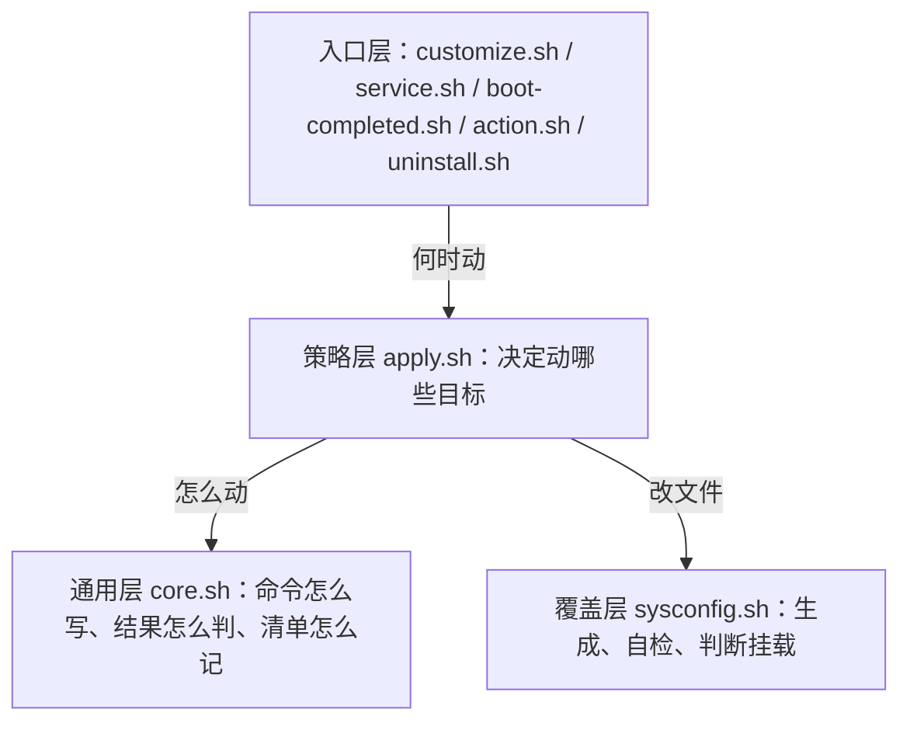
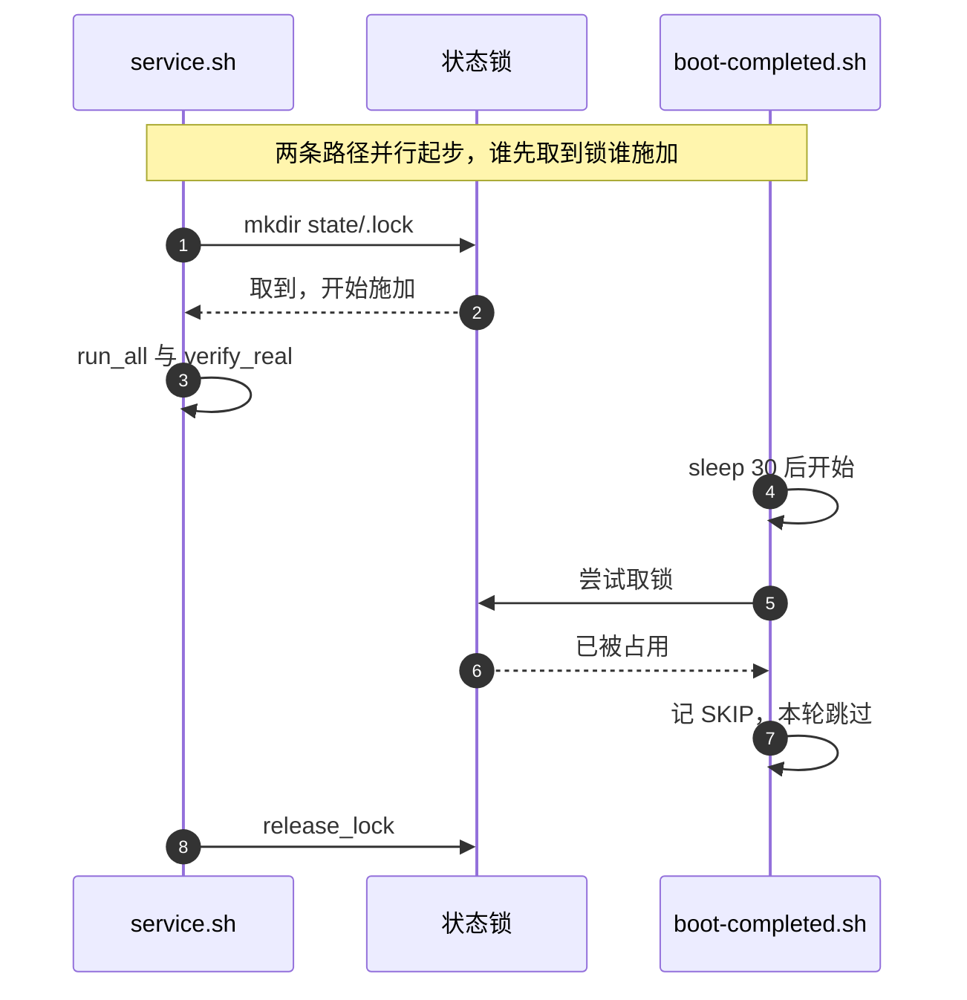
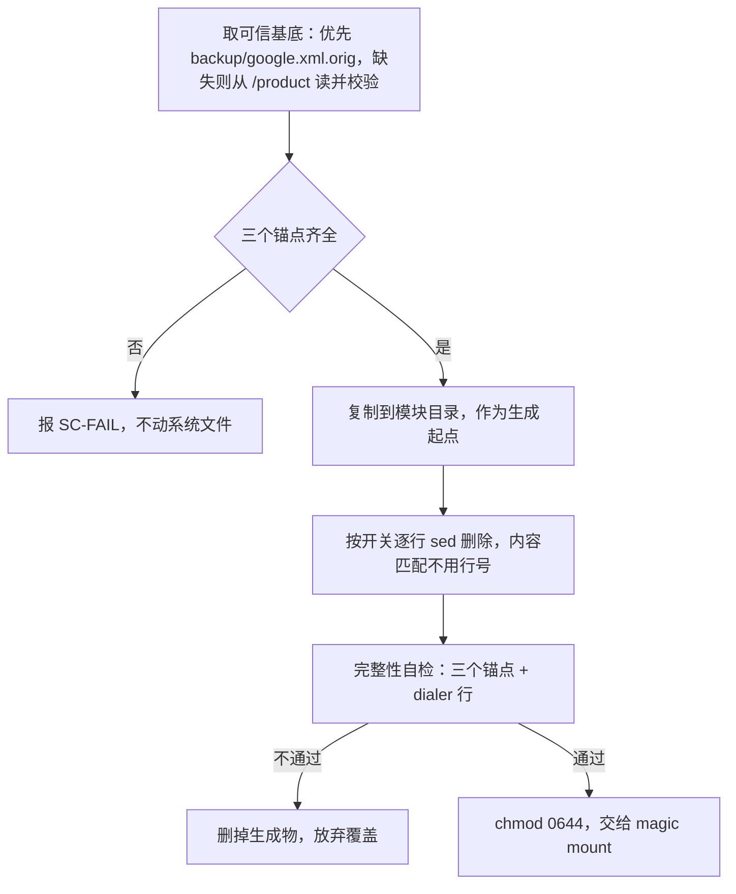

# 设计说明

模块只有两种改动系统的方式：调运行时接口改状态，或者换掉系统读到的文件内容。
所有复杂度都在保证这两件事**可撤销、可验证、不互相踩**。

本篇讲它怎么组织的。系统为什么允许这么干、又不允许那么干，见 [platform-notes.md](platform-notes.md)。

## 一、两条改动路径

| 路径 | 手段 | 改的是什么 | 撤销方式 |
|---|---|---|---|
| 运行时 | `pm disable` / `pm revoke` / `cmd appops` / `settings` / `cmd device_config` | 系统数据库里的状态 | 清单驱动的 `uninstall.sh` |
| 文件 | systemless overlay 覆盖 `/product/etc/sysconfig/google.xml` | 系统读到的只读文件 | 卸载模块，挂载消失即复原 |

第二条路径存在的唯一理由：`google.xml` 里那几行豁免让 GMS 绕过系统级限制，而这些豁免**没有命令行接口可以改**。
定位、Doze 白名单的 `system` 条目都属于这一类。

## 二、分三层



| 层 | 文件 | 职责 | 不知道什么 |
|---|---|---|---|
| 入口层 | 5 个入口脚本 | 决定「什么时候动」 | 具体怎么动 |
| 策略层 | `apply.sh` 256 行 | 决定「动哪些目标」 | 命令怎么写 |
| 通用层 | `core.sh` 340 行 | 命令怎么写、结果怎么判、清单怎么记 | 为什么要改 |
| 覆盖层 | `sysconfig.sh` 125 行 | 生成、自检、判断挂载 | 运行时状态 |

分层的作用是可测试：`apply.sh` 与 `sysconfig.sh` 都能被 `action.sh` 单独调起来跑一遍，不需要开机。

## 三、执行时序

| 时机 | 脚本 | 前置等待 | 做什么 |
|---|---|---|---|
| 安装 | `customize.sh` | 无 | 修权限、首次生成 `config.sh`、生成 overlay。**不调 `pm` / `cmd`** |
| 开机 | `service.sh` | 等 `sys.boot_completed`（≤300 秒）→ 等 `/data/data/android`（≤120 秒）→ `sleep 15` | 取锁，`run_all` |
| 开机完成 | `boot-completed.sh` | `sleep 30` | 记 overlay 挂载状态，取锁，再跑一遍 `run_all` |
| 手动 | `action.sh` | 无 | 打印现状面板 → 按当前开关重新生成 overlay → 取锁跑 `run_all` |
| 卸载 | `uninstall.sh` | 无 | `rollback_all` |



`service.sh` 的三段等待对应三件事：系统启动完成、`/data` 解密完成（Direct Boot 期间 `pm` 不可用）、包管理器扫描完成（`wait_cmd_ready` 还会用 `cmd appops get` 探活，最多 6 次，每次 10 秒）。

## 四、单项施加流程

`apply_change()` 处理三类「读得到真实值」的手段：`appops`、`devconfig`、`settings`。

```sh
apply_change() {
  _cur=$(kv_read "$_t" "$_k")        # 1. 读系统现值
  [ "$_cur" = "$_w" ] && return 0    # 2. 已是目标值，SKIP
  [ "$DRY" = "1" ] && return 0       # 3. 沙盘模式，只打印
  man_has || man_add "$_t" "$_k" "$_cur" "$_w"   # 4. 先记原值
  kv_write "$_t" "$_k" "$_w"         # 5. 写入
  [ "$(kv_read ...)" = "$_w" ] && OK || FAIL       # 6. 回读系统
}
```

顺序很关键：**先记原值，再写**。反过来写就丢了回滚依据。

`comp_change()`（组件）和权限分支结构相同，区别在第 6 步：它们回读的是本地快照，只能证明命令已下达，所以打 `SET` 而不是 `OK`。

## 五、清单与回滚

清单 `/data/adb/gmscore-slim/state/manifest.tsv` 记四列：类型、键、原值、写入值。

状态为什么必须外置？overlay 生效后模块目录被 magic mount 整块替换，写在里面的东西读不到。放 `/data/adb/gmscore-slim/` 就绕开了这个坑。

回滚只还原自己的改动：

```sh
_cur=$(kv_read "$_t" "$_k")
if [ "$_cur" = "$_w" ]; then
  kv_restore "$_t" "$_k" "$_o"   # 现值仍是我写的 → 还原
else
  KEEP                            # 别人改过 → 不动
fi
```

`device_config` 有额外一步。施加用 `override`（sticky 本地覆盖，优先级高于 `put`），回滚必须 `clear_override` 再 `put` 原值。
只 `put` 不清，会残留一条 override，其他模块改同一个键时改不动。

`uninstall.sh` 优先加载 `/data/adb/gmscore-slim/lib/core.sh` 副本，而不是模块目录里的，理由同上：卸载时模块目录可能已被替换或删除。

## 六、真实复核：SET 不等于 OK

组件和权限的「写后回读」是本模块踩过的最严重的自证陷阱，历史见 [platform-notes.md](platform-notes.md#四快照自证回读永远成功)。

现在的处理：

1. 单条日志从 `OK` 改成 `SET`，措辞上不再假装校验过。
2. `run_all` 结尾调 `verify_real()`：重新执行 `gms_snapshot` 与 `perm_snapshot`（各一次整包 dump），拿清单里本模块写入的值逐条比对，输出 `VERIFY-OK` / `VERIFY-FAIL`。
3. 一轮只多两次 dump，不是每项一次。

这就是为什么判断结果只看日志结尾的 `VERIFY` 行，不看中间的 `SET` 行。

`verify_real` 会更新 `disabled.txt` 与 `perms.txt` 快照，所以它既是校验，也顺手把本地快照刷新成系统真值。

## 七、overlay 生成与判据

### 7.1 生成



> [!NOTE]
> 图里两条失败分支都是刻意的默认姿态：宁可这次不生效，也不把系统文件改坏。

三个要点：

- **基底必须是原版备份**。模块挂了 overlay 之后再读 `/product/etc/sysconfig/google.xml`，读到的是自己的产物，sed 会在已删过的基础上继续删，行数一路递减。
- **用内容匹配删行**，不用行号，避免系统版本差异。
- **生成后自检**：`update-ownership`、`backup-transport-whitelisted-service`、`<config>` 必须还在；`com.google.android.dialer` 那行必须还在。任一缺失就放弃覆盖。

放弃是本模块的默认姿态：宁可这次不生效，也不把系统文件改坏。

### 7.2 判据

「是否已挂载」不能比「两个文件是否不同」，因为处理版和原版本来就不同，这个判据恒真。

实际判据是三方 md5：

| 条件 | 结论 |
|---|---|
| 系统文件 md5 == 模块内生成版 md5 | `MOUNTED` |
| 系统文件 md5 == 备份原版 md5 | `NOT-MOUNTED` |
| 两者都不等 | `UNKNOWN`，可能被别的模块覆盖 |

### 7.3 开关变化时

改完开关点「操作」，`action.sh` 会按新开关重新生成 overlay。已挂载的文件在本次开机期间不变，**重启后**才按新内容挂载。
这是 overlay 的固有性质，不是实现缺陷。

## 八、并发与幂等

| 机制 | 实现 | 解决什么 |
|---|---|---|
| 运行锁 | `mkdir state/.lock` 原子成功；失败则看时间戳，超过 600 秒视为残留并回收 | `service.sh` 与 `boot-completed.sh` 撞车 |
| 幂等 | 每项先读现值，等于目标值就 `SKIP` | 反复跑不会累积改动 |
| 两遍施加 | `boot-completed.sh` 再跑一次 | GMS 会自愈被 bind 的活跃服务 |

锁不是可选的。`service.sh` 在开机后 15 秒就得开始施加，`boot-completed.sh` 30 秒后也要跑，两者重叠是常态。

## 九、三条硬护栏

| 护栏 | 位置 | 行为 |
|---|---|---|
| 核心域保护 | `guard_core()` | 组件名命中 `*Gcm*`、`*.auth.*`、`*.common.*`、`*Chimera*` 时跳过。遥测与常驻两项在禁用前都过一遍 |
| `SYSTEM_FIXED` 跳过 | `perm_locked()` | 权限在 `perms-locked.txt` 里就记 `LOCKED`，不发 `pm revoke` |
| overlay 自检 | `sc_sane()` + dialer 检查 | 不通过就删掉生成物，不覆盖系统文件 |

`guard_core` 的一个例外：`FEATURE_DROIDGUARD` 分支直接处理 `*.droidguard.*`，不过 `guard_core`，否则整个分支会被自己的规则筛空。

## 十、明确不做的事

- 不 `pm disable-user` 或 `suspend` GMS 本体。
- 不杀进程，不调 `oom_score_adj`。
- 不改 `backup_transport`、`credential_service` 这类账号与备份的骨架。
- 不改 `activity_manager`（那个方向已经被内核调优模块占着，见 [platform-notes.md](platform-notes.md#七与内核调优模块的关系)）。
- 不追求「禁用 400 个组件」这类数字，只动本机实测存在且实测有效的目标。
