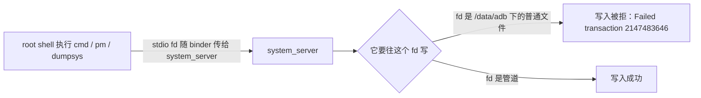

# 平台笔记

本模块的每个设计决定，背后都是一条 Android 平台的限制或一个踩过的坑。
本篇记录这些限制、验证它们的证据，以及踩坑时看到的现象。

环境：Android 17 / SDK 37、HyperOS V816、`ro.build.type=user`、KernelSU 3.3.1 + magic_mount_rs、GMS 26.43.30。
以下结论均在本机实测，换系统版本可能不同。

## 一、能力边界

| 手段 | 结果 | 关键证据 |
|---|---|---|
| `pm disable <组件>` | 有效 | 禁 3 个常驻服务后 `startRequested` 52 → 21，`pm enable` 可还原 |
| `pm revoke <非 SYSTEM_FIXED 权限>` | 有效 | `BLUETOOTH_SCAN` granted → false，对应 appop 级联成 `Uid mode: ignore` |
| `cmd device_config override` | 有效且 sticky | 写入后 `list_local_overrides` 有记录；再 `put` 反值，`get` 仍返回 override 值 |
| `settings put global` | 有效 | 写 `device_idle_constants` 后读回一致 |
| `cmd appops set <非运行时 op>` | 有效 | `RUN_ANY_IN_BACKGROUND` / `WAKE_LOCK` / `START_FOREGROUND` |
| `cmd appops set <运行时 op>` | 平台拒绝 | logcat：`appop state for runtime op ... should not be set directly` |
| `pm revoke <SYSTEM_FIXED 权限>` | 无效 | 返回 0，但 `granted` 仍是 true |
| `pm set-permission-flags` 去 `SYSTEM_FIXED` | 无效 | CLI 的 flag 白名单里没有这一项 |
| `cmd deviceidle whitelist -system` | 无此语法 | 返回 `Package must be prefixed with +, -, or =` |
| `cmd package get-component-enabled-setting` | 命令不存在 | 返回 `Unknown command` |
| `pm check-permission` | 命令不存在 | 同上 |

最后两行的后果：**没有单点查询组件状态或权限状态的 CLI**，只能整包 `pm dump` / `dumpsys package` 再解析。
这直接决定了 `verify_real()` 的形状——一轮两次 dump，而不是每项一次。

## 二、平台为什么这样

三条 AOSP 层面的原因，不是本机特例：

1. **运行时 op 由权限派生**。Android 16 起，runtime 权限映射的 appop 不再存独立 mode，而是从权限 flags 派生（`getUidModeFromPermissionState`）。
   所以 `setPackageMode` 直接 return，`setUidMode` 返回 false。官方替代路径就是改权限本身，`pm revoke` 会把 appop 级联成 `Uid mode: ignore`。
2. **root 也 revoke 不掉 `SYSTEM_FIXED`**。`revokeRuntimePermissionInternal` 判断的是 `callingAppId != SYSTEM_UID`（1000），uid 0 也过不去。
3. **`updatePermissionFlags` 会清 mask**。对非 SYSTEM_UID 调用时，它会把 `FLAG_PERMISSION_SYSTEM_FIXED` 从 mask 里剔掉，所以没有 CLI 能去掉这个 flag。

本机 GMS 只有 4 个 `SYSTEM_FIXED` 权限[^system-fixed]：`ACCESS_FINE_LOCATION`、`ACCESS_COARSE_LOCATION`、`ACCESS_BACKGROUND_LOCATION`、`ACTIVITY_RECOGNITION`。
恰好就是最想压的那几个。

## 三、坑一：`cmd` / `pm` / `dumpsys` 的 stdio fd

这是最反直觉的一个。同一个命令，加不加重定向，行为完全不同。

### 3.1 stdout 指向普通文件会失败

```sh
pm dump com.google.android.gms > /data/adb/gmscore-slim/state/gms.dump
# 文件只有 70 字节：
# cmd: Failure calling service package: Failed transaction (2147483646)
```

写 `/data/adb`、`/data/local/tmp`、`/sdcard` 都一样失败，退出码 2。




根因：`cmd` / `pm` / `dumpsys` 会把 stdio 的 fd 通过 binder 传给 system_server。stdout 是 root 打开在 `/data/adb`（context `adb_data_file`）下的普通文件时，system_server 写不了这个 fd，事务失败。

正确写法：

```sh
pm dump com.google.android.gms </dev/null 2>/dev/null | cat >"$STATE_FILES/gms.dump"
```

先走管道交给子 shell，由子 shell 重定向。

### 3.2 stdin 指向普通文件会静默失败

这个比上一条危险，因为不报错。

```sh
while IFS="$TAB" read -r t k o w; do
  cur=$(cmd appops get ...)   # ← stdin 继承自清单文件
done <"$MANIFEST"
```

`cmd` 把 stdin 也传给 system_server，事务失败，错误被 `2>/dev/null` 吞掉，变量成空值。

> [!CAUTION]
> 这一条比上一条危险，因为不报错。回滚会「看起来正常但判错」，把该还原的项判成 KEEP，用户的改动留在系统里出不去。
回滚时「现值」读成空，判定成「已被别人改过」，于是 `KEEP` 跳过——日志看起来正常，但用户的改动留在系统里出不去。

三种写法都行，本模块用第一种：

```sh
# 1. 每个外部命令显式 </dev/null（core.sh 里全部如此）
cmd appops get "$pkg" "$op" </dev/null 2>/dev/null

# 2. 先把清单读进内存
_mlist=$(cat "$MANIFEST"); printf '%s\n' "$_mlist" | while read ...

# 3. 循环体另开 fd
while read -r ... <&3; do ...; done 3<"$MANIFEST"
```

**通用规则**：本项目里任何调用 `cmd` / `pm` / `dumpsys` / `am` / `settings` 的地方，都假设 stdin 可能是普通文件，一律显式 `</dev/null`。
`rollback_all` 同时用了第 1 和第 2 种，是双保险。

## 四、快照自证：回读永远成功

`comp_read` / `perm_read` 读的是 `/data/adb/gmscore-slim/state/` 下的快照，不是系统。
`kv_write` 在执行 `pm disable` / `pm revoke` 之后立刻把快照改成目标值，于是：

```sh
kv_write comp "$_c" "$_w"    # 内部：pm disable，然后把 disabled.txt 加上这行
_v=$(comp_read "$_c")        # 读的是刚改过的快照
[ "$_v" = "$_w" ] && log OK  # 恒成立
```

`pm disable` 明明失败了，日志照样打 `OK`。这是个真 bug，修法见 [design.md](design.md#六真实复核set-不等于-ok)。

类似的坑还有第三形态：快照生成时机不对也会误报 FAIL。

```sh
gms_snapshot                 # disabled.txt 里没有该组件
comp_change "$c" disabled    # pm disable 实际成功
# → FAIL comp ... 期望 disabled 实际 enabled
```

原因是 `comp_read` 读的还是 `gms_snapshot` 那一刻的旧值。修法是写入时同步快照（`comp_cache_set` / `perm_cache_set`），让「写入 → 回读」落在同一份事实上。

## 五、解析 GMS 组件时的三个陷阱

### 5.1 `grep -A N 'disabledComponents:'` 会溢出到权限表

`pm dump` 里 `disabledComponents:` 之后先列被禁组件，紧接着是几千行权限表。
用 `grep -A 3000` 会把权限名当组件名抓进来。实测真实 103 个，按 `-A` 抓成 520 个，结论一度写成「已禁用 406 个」。

正确写法是按段落边界截取：

```sh
sed -n '/^      disabledComponents:/,/^      [a-zA-Z]/p' "$dump"
```

### 5.2 组件名是相对名

`pm dump` 的解析表和 `dumpsys activity services` 都写作 `com.google.android.gms/.chimera.GmsApiService`。
直接 `grep -oE 'com\.google\.android\.gms\.[A-Za-z0-9_.]+'` 抓不到，必须还原：

```sh
grep -oE 'com\.google\.android\.gms/[A-Za-z0-9_./]+' \
  | sed -E 's|.*com\.google\.android\.gms/||' \
  | sed -E 's|^\.|com.google.android.gms.|'
```

### 5.3 intent action 不是组件

`com.google.android.gms.usagereporting.GOOGLE_SETTINGS`、`...OPTIN_UR` 是 action 常量，不能 `pm disable`。
筛组件名要加后缀过滤：`grep -iE '(Service|Receiver|Activity|Provider|Alias)$'`。

## 六、overlay 的三个坑

### 6.1 基底必须用原始备份

模块挂上 overlay 之后，再读 `/product/etc/sysconfig/google.xml` 读到的是自己的产物。
每次都从这里取基底，`sed` 会在已删过的基础上继续删，行数一路递减。

做法：首次从系统读一份存到 `backup/google.xml.orig`，之后一律以备份为基底。
实测连续生成 3 次恒为 106 行，不累积。

### 6.2 生成后必须自检

`google.xml` 里有一批删了就真出事的行：

| 行 | 删了会怎样 |
|---|---|
| `update-ownership ... installer="com.android.vending"` | Play 商店无法升级 GMS |
| `backup-transport-whitelisted-service` | 备份、换机迁移失效 |
| `app-data-isolation-whitelisted-app` | 数据隔离白名单失效 |
| `<app-link>` | 应用链接失效 |

最容易误伤的是 `allow-ignore-location-settings`：它有**两行**，GMS 一行、`com.google.android.dialer` 一行（第 12 行）。
按前缀模糊匹配会把 dialer 一起删，影响紧急呼叫定位。所以删除语句必须带完整包名，并且自检里单独查 dialer。

### 6.3 判「是否已挂载」不能用「两文件是否不同」

处理版和原版本来就不同，这个判据恒真，会误报 `MOUNTED`。第一版实现就犯了这个错，测试时复现。

正确判据是三方 md5 比对，见 [design.md](design.md#72-判据)。

## 七、与内核调优模块的关系

本机同时装着 `hanamaki_kernel`，它的 `activity_manager` 各项走 `device_config override`：

```
activity_manager/max_cached_processes=65535
activity_manager/use_freezer=false
activity_manager/no_kill_cached_processes_post_boot_completed_duration_millis=2147483647
activity_manager/use_compaction=false
activity_manager/max_phantom_processes=65535
activity_manager/kill_bg_restricted_cached_idle=false
```

两个影响：

1. **本模块不碰 `activity_manager`**。两边都改同一个键时会互相覆盖，而那个方向（不许回收、不许冻结）与省电目标相反。
2. **`FEATURE_ALARM_DELAY` 与它方向相反**。它把 `delay_nonwakeup_alarms_while_screen_off` 设为 `false`，本模块要设 `true`。默认关闭，确认没有别的模块写这个键再开。

另一个不确定项：`com.miui.powerkeeper` 的云端 `doze_whitelist_apps` 有覆盖用户白名单的迹象。这是社区报告，未在本机验证。
如果发现白名单「删了又回来」，先怀疑这一层。

## 八、`SYSTEM_FIXED` 与 overlay 的边界

常有一种误解：UGD 之类的模块用 overlay 解决了权限问题。不是这样。

- sysconfig XML 在只读系统分区，能被 magic mount 覆盖；
- 权限状态在 `/data/misc_de/0/apexdata/com.android.permission/access.abx`（Android 17 已是 ABX 二进制，`runtime-permissions.xml` 只剩 shared-user 名单），属 `/data` 可写区，overlay 碰不到。

所以 overlay 只能解决「GMS 无视系统开关」这类**豁免**问题，不能解决「权限改不掉」这类**权限状态**问题。
本模块用 overlay 删 `allow-ignore-location-settings`，效果是让 GMS 重新受系统定位总开关约束——权限本身仍然是 granted。

## 九、社区名单与自愈

### 9.1 社区精简名单在 26.x 已大面积失效

- `AppMeasurement*`、`CampaignTracking*`：GMS 26.43.30 上**不存在**。
- `.analytics`、`.snet`、`.herrevad`、`.pseudonymous`、`.car`：本机**零组件**。

所以本模块不硬编码组件名，一律从 `pm dump` 动态生成候选再过滤。硬编码的后果是一堆 `ABSENT`，更糟的是去 disable 不存在的名字。

### 9.2 GMS 会自愈被 bind 的活跃服务

实测：禁用 `MeasurementBrokerService` 后过一段时间再查 `dumpsys activity services`，它又出现了（14 处引用）；而 `ClearcutDebugDumpService` 被禁后保持禁用。

推论：被 bind 的活跃服务会被 GMS 自己重新启用，纯遥测类不会。
这解释了为什么 `boot-completed.sh` 要再复核一遍——不是冗余，是必要。

评估某个组件能不能压住，必须隔一段时间复查，不能只看禁用后那一刻。

[^system-fixed]: `SYSTEM_FIXED` 是权限的固定标记。系统应用在 manifest 里声明后，用户与命令行都改不掉，只有换 ROM 或直接改 `/data` 下的权限库才行。
