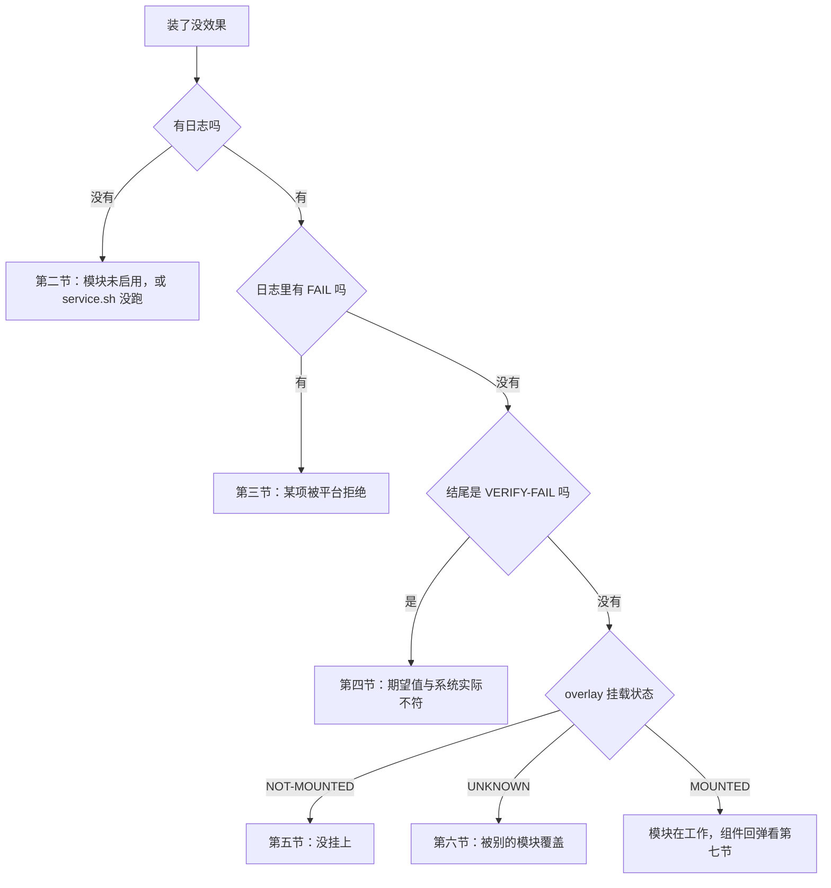

# 排障手册

先看日志，再看系统，最后才动手改配置。日志结尾的 `VERIFY` 行是本模块唯一可信的结论来源。

```sh
tail -n 40 /data/adb/gmscore-slim/log/last.log
```

日志超过 256 KiB 会轮转成 `prev.log`，跨重启的现象要去那里找。

## 一、症状索引

| 症状 | 跳到 |
|---|---|
| 刷完重启，什么都没变，也没有日志 | [2](#二日志根本不存在) |
| 日志里有 `FAIL` | [3](#三日志里有-fail) |
| 日志结尾 `VERIFY-FAIL` | [4](#四verify-fail) |
| overlay 显示 `NOT-MOUNTED` | [5](#五overlay-未挂载) |
| overlay 显示 `UNKNOWN` | [6](#六overlay-被别的模块覆盖) |
| 定位豁免行还在 | [5](#五overlay-未挂载) |
| 禁掉的组件过一阵又回来了 | [7](#七组件自己回来了) |
| 改了 `config.sh` 没反应 | [8](#八改了开关没反应) |
| 白名单删不干净 | [9](#九白名单删不干净) |
| 卸载后系统没恢复 | [10](#十卸载没恢复) |
| GMS 出问题，要立刻回退 | [11](#十一紧急回退) |

知道主症状但不确定先查哪里时，按这张图走；图上每一节都能在左边的表里找到。



## 二、日志根本不存在

```sh
ls -la /data/adb/gmscore-slim/
ls -la /data/adb/modules/gmscore-slim/
```

三种可能：

| 现象 | 原因 | 处置 |
|---|---|---|
| 目录都在，`log/` 是空的 | `service.sh` 没执行 | 确认管理器里模块是启用状态，重启一次 |
| `/data/adb/modules/gmscore-slim/` 没有 | 刷入失败，或刷完没重启 | 重新刷入 zip |
| 有 `update` 目录 | 管理器在等重启才启用 | 重启 |

手动跑一次，看能不能立即产出日志：

```sh
sh /data/adb/modules/gmscore-slim/action.sh
```

## 三、日志里有 `FAIL`

`FAIL` 只出现在 `appops` / `device_config` / `settings` 三类，含义是「写后回读不等于期望值」。组件和权限用 `SET`，不会出 `FAIL`。

```sh
grep FAIL /data/adb/gmscore-slim/log/last.log
```

| 失败的项 | 常见原因 | 处置 |
|---|---|---|
| `appops ... WAKE_LOCK` | 用了运行时 op（平台拒绝） | 本模块只用三个非运行时 op，出现即说明被改过代码 |
| `devconfig alarm_manager...` | 别的模块用 override 写了反值 | 二选一，见 [platform-notes.md](platform-notes.md#七与内核调优模块的关系) |
| `settings device_idle_constants` | 系统服务同步覆写 | 再点一次「操作」；仍失败就关掉该项 |

`FAIL` 不代表系统坏，只代表这一项没生效。其余项不受影响。

## 四、`VERIFY-FAIL`

含义：整轮结束重新抓系统状态，发现清单里的期望值和系统实际值不一致。

```sh
grep VERIFY /data/adb/gmscore-slim/log/last.log
```

| 伴随信息 | 原因 | 处置 |
|---|---|---|
| `VERIFY-FAIL 无法重新读取组件状态` | `pm dump` 连续失败 | 手动 `pm dump com.google.android.gms \| head` 看是否报 `Failed transaction` |
| `VERIFY-FAIL comp ... 期望 disabled 系统实际 enabled` | GMS 自愈，见 [7](#七组件自己回来了) | 等下一轮 `boot-completed` 复核 |
| `VERIFY-FAIL perm ... 期望 false 系统实际 true` | 该权限可能是 `SYSTEM_FIXED` | 看同轮日志有没有 `LOCKED`；有就属正常 |

> [!WARNING]
> 「无法重新读取」要当回事：它说明模块这一轮的复核是空的，不等于没有问题。

## 五、overlay 未挂载

```sh
grep -A3 'sysconfig:' /data/adb/gmscore-slim/log/last.log
wc -l /product/etc/sysconfig/google.xml
```

| 读数 | 含义 |
|---|---|
| `NOT-MOUNTED`，107 行 | overlay 没挂上 |
| `MOUNTED`，106 行 | 正常 |
| 模块里没有 `system/product/etc/sysconfig/google.xml` | overlay 根本没生成 |

按顺序查：

```sh
# 1. 开关是否关着
grep FEATURE_SYSCONFIG /data/adb/gmscore-slim/config.sh

# 2. 生成物在不在
ls -la /data/adb/modules/gmscore-slim/system/product/etc/sysconfig/

# 3. 重新生成一次
sh /data/adb/modules/gmscore-slim/action.sh | sed -n '/sysconfig/,$p'
```

`SC-FAIL` 说明自检没通过，模块主动放弃了覆盖。看紧跟的提示：

| 提示 | 处置 |
|---|---|
| 找不到可信的原始 google.xml | 删掉 `/data/adb/gmscore-slim/backup/google.xml.orig` 后重新点「操作」，让它从系统重读 |
| dialer 的 ignore-location-settings 被误删 | 是代码问题，提 issue |
| 生成结果未通过完整性校验 | 同第一条 |

生成成功但重启后仍是 `NOT-MOUNTED`：说明 magic mount 没把模块目录映射到 `/product`。检查是否有 magic mount 类模块在工作，以及模块目录里 `system/` 的层级是否正确（必须是 `system/product/etc/sysconfig/google.xml`，不是 `system/etc/...`）。

## 六、overlay 被别的模块覆盖

`UNKNOWN` 表示系统读到的内容既不是模块版，也不是原版。

```sh
ls /data/adb/modules/*/system/product/etc/sysconfig/google.xml 2>/dev/null
```

多个模块提供同一路径时会按加载顺序覆盖，后者赢。处置：只留一个改 `google.xml` 的模块，其余关掉。
原版备份在 `/data/adb/gmscore-slim/backup/google.xml.orig`，可以拿来对比差在哪：

```sh
diff /product/etc/sysconfig/google.xml \
     /data/adb/gmscore-slim/backup/google.xml.orig
```

## 七、组件自己回来了

现象：日志里 `SET comp ... disabled` 成功，过一段时间 `dumpsys activity services` 里它又出现了。

这是 GMS 的正常行为，不是失败：被 bind 的活跃服务会被重新启用，纯遥测类不会。
本模块的对策是 `boot-completed.sh` 再跑一遍。所以：

- 只要当轮 `VERIFY-OK`，这一轮就是成功的；
- 下次开机还会再压一次；
- 如果一个组件每次都被拉回来，说明它属于「被 bind 的活跃服务」，压不住是常态，别追。

确认它当前状态：

```sh
dumpsys package com.google.android.gms | \
  sed -n '/^      disabledComponents:/,/^      [a-zA-Z]/p' | grep -c gms
```

不要用 `grep -A 3000` 抓，会溢出到权限表，数字虚高数倍。

## 八、改了开关没反应

三个最常见的原因，按概率排：

1. **改错了文件**。模块目录里的 `module/lib/config.sh` 是模板，改它没有用。生效的是 `/data/adb/gmscore-slim/config.sh`。
2. **没点「操作」也没重启**。运行时项要点「操作」立即施加，overlay 项要重启才换挂载内容。
3. **开关依附关系**。`TELEMETRY_ADS` 依附 `TELEMETRY`，`PERM_PHONE` / `PERM_BTCONNECT` 依附 `PERM_SCAN`，主开关为 0 时子项不执行。

确认当前生效值：

```sh
sh /data/adb/modules/gmscore-slim/action.sh | sed -n '/===== 开关 =====/,/===== /p'
```

## 九、白名单删不干净

```sh
dumpsys deviceidle whitelist | grep com.google.android.gms
```

期望只能删掉 `user` 那一条。剩下 `system` 与 `system-excidle` 来自 `/product/etc/sysconfig/google.xml` 的 `allow-in-power-save`，命令行没有 `-system` 语法（返回 `Package must be prefixed with +, -, or =`）。

要让它们失效只能走 overlay：打开 `FEATURE_SC_POWERSAVE`，删掉 `allow-in-power-save` 那行。

若连 `user` 条目都删了又回来，怀疑 `com.miui.powerkeeper` 的云端 `doze_whitelist_apps` 在覆盖，这是社区报告，本机未验证。

## 十、卸载没恢复

```sh
grep -E 'RESTORE|KEEP' /data/adb/gmscore-slim/log/last.log
```

| 标记 | 含义 | 是否正常 |
|---|---|---|
| `RESTORE` | 已还原原值 | 正常 |
| `KEEP` | 现值已非本模块所设，跳过 | 正常，属设计 |

`KEEP` 多了要注意：说明你在模块生效期间手动改过这些项，模块不替你改回去。

若 `uninstall.sh` 报「找不到 core.sh」，改动清单还在 `/data/adb/gmscore-slim/state/manifest.tsv`，可以手动还原，或用 `git` 里那份 `module/lib/core.sh` 顶上：

```sh
cp /data/adb/modules/gmscore-slim/lib/core.sh /tmp/core.sh
. /tmp/core.sh && rollback_all
```

卸载后建议重启一次，让 GMS 回到干净状态。

## 十一、紧急回退

> [!CAUTION]
> 顺序不能反。运行时改动先清，overlay 撤除要重启，两者叠加才是完整回退。

GMS 登录、支付、推送出问题，按两步恢复，越快越好。

**第一步：清运行时改动**（不用重启）

```sh
sh /data/adb/modules/gmscore-slim/uninstall.sh
```

组件重新 `pm enable`，权限重新 `pm grant`，`device_config` 先清 override 再写回原值。跑完 GMS 立刻恢复被禁的组件。

**第二步：撤 overlay**（需要重启）

在管理器里卸载模块，然后重启。挂载消失，`/product/etc/sysconfig/google.xml` 回到原版。

如果只想撤 overlay、保留运行时改动：把 `FEATURE_SYSCONFIG=0` 写进 `config.sh`，点「操作」，删掉生成物，再重启。

```sh
rm -rf /data/adb/modules/gmscore-slim/system
```

单把开关设为 0 不会删除已生成的文件，文件还在就会继续被挂载。`action.sh` 会提示这一点。

## 十二、开机变慢

`service.sh` 最多等 5 分钟启动完成 + 2 分钟解密 + 15 秒稳定，这些等待本身不阻塞开机，只在后台跑。
若确实感觉变慢，看服务里有没有卡住：

```sh
ps -A | grep -E 'service.sh|boot-completed'
cat /data/adb/gmscore-slim/state/.lock 2>/dev/null
```

`.lock` 目录存在且超过 10 分钟，说明上一轮卡死，被下一轮的残留回收机制清掉；此时日志开头会有 `SKIP 已有实例在运行` 或新一轮正常开始。这两种都可接受。

## 十三、收集信息提 issue

<details>
<summary>一键收集脚本（点开复制）</summary>

```sh
{
  echo "## 环境"
  getprop ro.build.version.release
  getprop ro.build.version.sdk
  getprop ro.product.cpu.abi
  dumpsys package com.google.android.gms | grep -m1 versionName
  echo "## 日志"
  cat /data/adb/gmscore-slim/log/last.log
  echo "## 清单"
  cat /data/adb/gmscore-slim/state/manifest.tsv
  echo "## overlay"
  wc -l /product/etc/sysconfig/google.xml
  ls -la /data/adb/modules/gmscore-slim/system/product/etc/sysconfig/ 2>/dev/null
} > /sdcard/gmslim-report.txt
```

</details>

清单里是包名和状态值，不含个人数据。
